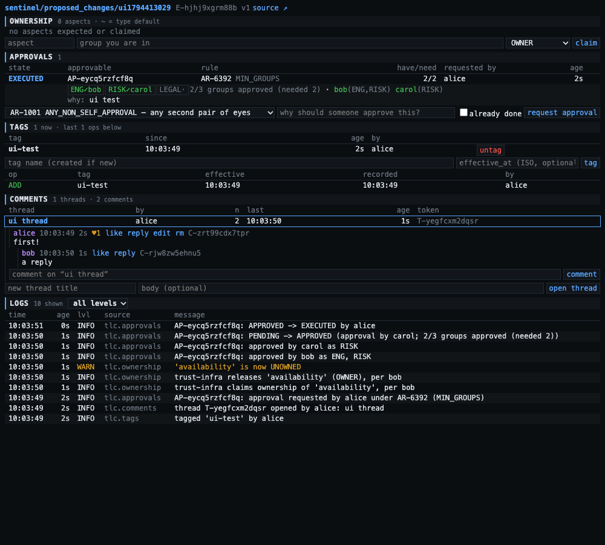
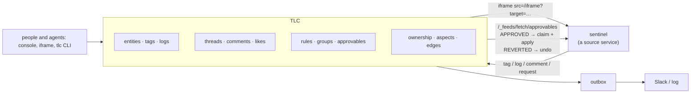

# TLC — tags, logs, comments (& approvals & ownership & entities & items)

> Names like `sentinel`, `ATO_VELOCITY`, `trust-infra` and `alice` are a made-up example company: [who and what they are](docs/example-world.md).

One small service that gives *other* services the cross-cutting stuff they keep re-building badly:
tag a row, hang a log on it, discuss it, say who owns which aspect of it, and gate a change to it on
an approval rule: some people (or agents) agreeing, some automated checks passing, about one
specific revision of the row. The source service keeps its own tables; TLC only ever learns the
triple `service/entity/id` and, for approvals, which version (`…/1234@3`).

What a rule requires is the deploying team's policy, not TLC's. The rules in these docs are examples.

It also keeps one list of its own: **items**, the open loops waiting on a person (a todo, a question, a service
that is behind, a chore due tonight), with the history of what the person did when shown each one, and a way to
hand one to an agent and get the result back. See [items](docs/items.md).



More of the UI, panel by panel: [approvals](docs/approvals.md) · [comments](docs/comments.md) · [ownership](docs/ownership.md) · [console](docs/embedding.md).

Kotlin + [misk](https://github.com/cashapp/misk), raw SQL over misk-jdbc, MySQL. JSON over HTTP.
Port **8790**. Built from a one-page note, [`docs/2020_scribble.md`](docs/2020_scribble.md), taken in 2020 while
riskarbiter2020 was being implemented and its approvals needed to be more flexible than they were;
[`docs/decisions.md`](docs/decisions.md) records how each line of it was read.



## Run it

```sh
. bin/activate-hermit                      # JDK 21 (every new shell)
mysql -uroot -h127.0.0.1 -e 'create database if not exists tlc_dev; create database if not exists tlc_test'
./gradlew run                              # foreground; migrations apply at startup
scripts/dev-restart.sh                     # …or: rebuild + restart in the background (log: build/tlc-run.log)
scripts/seed.sh                            # the sentinel/proposed_changes/1234 scenario
open http://localhost:8790/                # console        (type an ldap into "as")
open http://localhost:8790/demo            # a fake source-service page embedding the iframe
scripts/demo.sh                            # all nine narrated demos (≈25 s; re-runnable, each run uses fresh ids)
./gradlew test                             # 42 tests: 31 over real HTTP + MySQL, 6 on auth, 5 on the approval engine
```

Start over: stop the server, `mysql -uroot -h127.0.0.1 -e 'drop database tlc_dev; create database tlc_dev'`, start it, re-seed.

`tlc.admins` (default `[traviscj]`) may write approval rules and the group directory. Out of the box identity is the
`X-TLC-User` / `X-TLC-Service` header — **trusted, not verified**. Anywhere a stranger can reach it, turn on one
or more of the verified ways in (`docs/operations.md`):

| caller | config | how |
|---|---|---|
| people in a browser | `tlc.proxy_auth` | an authenticating reverse proxy (oauth2-proxy) names the signed-in user and proves itself with a shared secret |
| scripts, hooks, cron | `tlc.api_tokens` | a static `Authorization: Bearer tlc_…` token per service, stored as a SHA-256 (`scripts/tlc mint-token <service>`) |
| services with an IdP client | `tlc.oidc` (+ `oidc_services`) | an OIDC bearer JWT (written against Pocket ID), verified against the issuer's JWKS |

`deploy/` has a Dockerfile, a compose file, an example config and an example Caddy vhost for that setup.

## Thirty seconds of API

```sh
H='-H X-TLC-User:alice -H Content-Type:application/json'; U=localhost:8790; E=sentinel/proposed_changes/1234
curl $H $U/api/taggings/tag  -d "{\"target\":\"$E\",\"tag\":\"urgent\",\"create_tag\":true}"
curl $H "$U/api/taggings/is-tagged?target=$E&tag=urgent"                       # is tagged
curl $H "$U/api/taggings/is-tagged?target=$E&tag=urgent&at=2026-01-15T00:00:00Z" # was tagged (then)
curl $H $U/api/logs          -d "{\"target\":\"$E\",\"level\":\"WARN\",\"message\":\"backtest sample small\"}"
curl $H $U/api/threads       -d "{\"target\":\"$E\",\"title\":\"is 20 right?\"}"
curl $H $U/api/approvables   -d "{\"target\":\"$E\",\"revision\":\"3\",\"rule\":\"AR-6392\",\"context\":\"12 -> 20\"}"  # approve 1234@3
curl $H "$U/api/summary?target=$E"                                             # everything about it
curl $H $U/api/items         -d '{"title":"call the roofer","kind":"property","due_at":"2026-12-01T15:00:00Z"}'   # an open loop
curl $H "$U/api/items"                                                          # what is waiting, most pressing first
```

Same thing through the CLI (`scripts/tlc --help`); both verb sets from the note work on every noun:

```sh
tlc thread mk "is 20 right?" --target $E      # == tlc thread create …
tlc comment ls T-…  |  tlc comment edit C-… "…"  |  tlc comment rm C-…  |  tlc comment like C-…
tlc tag is $E urgent && echo tagged           # exit status is the answer
tlc ap approve AP-… --rev 3 ; tlc ap execute AP-… --rev 3   # execute exits 3 if someone else already claimed it
tlc ap revise AP-… --rev 4 --context "12 -> 16"   # the change was edited: approvals of @3 are dismissed (or kept, per rule)
tlc --service sentinel ap check AP-… flag_rate_delta_pct --value -6.2   # a machine's assertion; the rule holds the bound
tlc item add "reply to the inspector" --kind todo ; tlc item ls ; tlc item snooze I-… --ttl 86400 ; tlc item done I-…
tlc item sync srcage < behind.json            # a derived source's whole current set: what it omits closes itself
tlc item delegate I-…                         # hand it to an agent; a worker claims it and reports back onto the item
```

## Ownership (added after the note)

"Owner of a rule" turned out to be three different teams depending on what broke, so ownership is
per **aspect** of a record ([docs/ownership.md](docs/ownership.md)):

```sh
tlc own expect sentinel/rules disposition --desc "…"  # every rule should have an owner for this, and what that means
tlc --as bob  own claim 'sentinel/rules/*' availability trust-infra    # type-wide default
tlc --as olga own claim sentinel/rules/ATO_VELOCITY disposition trust-ops   # per record
tlc own of sentinel/rules/ATO_VELOCITY [--at 2026-10-01T00:00:00Z]       # who owns what (then)
tlc own coverage ; tlc own gaps                     # % of cells with exactly one live owner; the rest
tlc edge mk sentinel/signals/velocity_24h sentinel/rules/ATO_VELOCITY     # signal -> rule -> trigger -> hook
tlc own affected sentinel/signals/velocity_24h       # who is on the hook downstream if it breaks
tlc rule mk --requirement ALL_GROUPS --desc "disable a rule" --aspect availability --aspect disposition --aspect efficacy:notify
tlc --service sentinel --as alice ap mk sentinel/rules/VEL_2 AR-3005 --impact availability=0 --impact disposition=-18:flags/day
                                                    # declared impact under the rule's threshold: that owner is told, not asked
tlc --as bob ap mk sentinel/signals/velocity_24h AR-3003 --ratify   # break-glass: done already; reverts unless ratified
```

## The note → the code

The note is [`docs/2020_scribble.md`](docs/2020_scribble.md), kept as written.

| note | where | doc |
|---|---|---|
| Entities: create / read / update / destroy | `Entities.kt` — types explicit, records vivified on first reference | [entities](docs/entities.md) |
| external entity types, external entities, tlcers | `v001`–`v003` | [data model](docs/data-model.md) |
| tags (icuvt + effectivity), taggings (ADD\|REMOVE, ldap, service, feed) | `Tags.kt`, `v004`–`v005` | [tags](docs/tags.md) |
| create tag · tag/untag · is tagged · was tagged | `/api/tags`, `/api/taggings/*` | [tags](docs/tags.md) |
| log entries (timestamp, level, message, source, type, entity) | `Logs.kt`, `v006` | [logs](docs/logs.md) |
| threads (cached_comments), comments (fsi, shard, thread_path), likes | `Comments.kt`, `v007`–`v009` | [comments](docs/comments.md) |
| iframe · thread\|comment × create/read/update/destroy × mk/ls/edit/rm · like | `/iframe`, `/api/threads`, `/api/comments`, `scripts/tlc` | [embedding](docs/embedding.md) |
| approvable, approvals, approval rule, rules→groups | `Approvals.kt`, `v010`–`v015` | [approvals](docs/approvals.md) |
| "alternatives to approval": Slack / email notification | `SLACK_NOTIFICATION` / `EMAIL_NOTIFICATION` requirements + outbox | [approvals](docs/approvals.md#notifications) |
| "+ feed", "fsi, shard" | `Feeds.kt` on the `misk-feedz` library, `/_feeds/fetch/{taggings,threads,comments,approvables,ownerships}`, `/_admin/feedz/` | [feeds](docs/feeds.md) |
| *(not in the note)* revisions of what is approved, comments per revision, automated checks, agents as approvers, a configurable requirement menu | `Approvals.kt`, `Comments.kt`, `v028`–`v040` | [approvals](docs/approvals.md) · [comments](docs/comments.md#on-a-request-and-at-a-revision) |
| *(not in the note)* items: open loops from captured and derived sources, a fixed ordering rule, the shown / picked / snoozed / done event log, delegation to an agent | `Items.kt`, `/api/items`, `v042`–`v044` | [items](docs/items.md) |
| *(not in the note)* static API tokens, proxy-attested sign-in, container deploy | `Auth.kt`, `deploy/` | [operations](docs/operations.md) |
| *(not in the note)* ownership per aspect, coverage, dependency edges, aspect-resolved rules, break-glass | `Ownership.kt`, `Approvals.kt`, `v017`–`v023` | [ownership](docs/ownership.md) |

Every endpoint: [docs/api.md](docs/api.md). Config, auth, deploy notes: [docs/operations.md](docs/operations.md).

## Demos

All nine recordings on one page, playable in the browser: <https://tcj.io/s/fhz0ztk3q0ijsl32cmd28v3n1jvl/> (GitHub does not play the mp4s in `docs/recordings/` inline).

| script | shows |
|---|---|
| `scripts/demos/01-entities.sh` | unregistered types refused; records vivify; soft destroy + revive · [recording](docs/recordings/01-entities.mp4) |
| `scripts/demos/02-tags.sh` | idempotent tag/untag; backdating; was-tagged windows; `known_at`; retiring a tag; tagging a thread · [recording](docs/recordings/02-tags.mp4) |
| `scripts/demos/03-logs.sh` | append/batch; level, source-prefix, substring filters; TLC's own audit entries; tail · [recording](docs/recordings/03-logs.mp4) |
| `scripts/demos/04-comments.sh` | nested replies in path order; like episodes; author-only edit; tombstones · [recording](docs/recordings/04-comments.mp4) |
| `scripts/demos/05-approvals.sh` | every requirement type; the distinct-people matching; withdraw; admins-only; notify-only; decline; service-on-behalf-of; forced rule change; outbox; audit trail · [recording](docs/recordings/05-approvals.mp4) |
| `scripts/demos/06-feeds.sh` | a source service tailing `approvables` and claiming APPROVED changes exactly once · [recording](docs/recordings/06-feeds.mp4) |
| `scripts/demos/07-curl.sh` | the whole flow in bare curl against a second service (`billing/invoices`) · [recording](docs/recordings/07-curl.mp4) |
| `scripts/demos/08-ownership.sh` | aspects; type defaults; CONTESTED; time travel; coverage + gaps; blast radius over the graph; rules that resolve approvers from owners; `applies_to`; declared impacts vs thresholds; break-glass ratified and reverted · [recording](docs/recordings/08-ownership.mp4) |
| `scripts/demos/09-revisions-checks-agents.sh` | a request pinned to `…@3`; checks with the bound on the rule; discussion on the request; revise to `@4` dismissing approvals; execute only the approved revision; a second rule that keeps approvals and admits agents · [recording](docs/recordings/09-revisions-checks-agents.mp4) |
| `/demo` in a browser | a "sentinel" page embedding the iframe; switch the viewer between alice/bob/carol |
| `scripts/ui_smoke.py` | Playwright click-through of the iframe and console (optional; needs Playwright) |

## Layout

```
src/main/kotlin/tcj/tlc/   TlcApp TlcModule TlcConfig · Db (tx + SQL helpers) · Auth (actors, tlcers)
                           Entities · Tags · Logs · Comments · Approvals (directory, rules, engine, approvables, outbox)
                           Ownership (claims, cells, coverage, edges, party resolution)
                           Items (open loops: capture, whole-set sync, ordering, events, delegation)
                           Feeds (publisher, transport, background loop) · Web (pages, /api/info, /api/summary)
src/main/resources/        migrations/v001…v044 (one statement per file) · web/{console,iframe,demo}.html tlc.{js,css}
src/test/kotlin/tcj/tlc/   TlcServiceTest (HTTP + MySQL) · TlcOidcTest (the verified ways in) · ApprovalEngineTest
scripts/                   tlc (CLI) · seed.sh · demo.sh · demos/ · dev-restart.sh · ui_smoke.py · ui_shots.py
                           loops-checkpoint.py (a Claude Code hook: session work -> logs, and an open-loops reminder)
deploy/                    Dockerfile · docker-compose.yml · tlc.yaml.example · Caddyfile.example
```

## Not done (on purpose, so far)

- **A real group directory.** `directory_memberships` is a local stand-in for the company directory (Okta, Google Groups, LDAP).
- **Running checks, waiving them, timing them out.** TLC records what a service reports and compares it with the rule's bound; it computes nothing, a failed check cannot be waived, and one that never reports stays `MISSING`.
- **Requirement types beyond the seven shipped** (k-of-one-group, weighted, veto, staged, expiring): see the menu in `docs/approvals.md`.
- **Re-resolving who is asked when a request is revised.** Parties and impacts are frozen at filing; decline and refile.
- **Agent identity from the IdP.** "Is an agent" comes from TLC's own `agents` table.
- **Email transport.** EMAIL notifications land in the outbox and the service log, nothing is sent. Slack sends only if `slack_webhook_url` is set (never exercised against real Slack).
- **Retention / hard delete.** Everything is soft-deleted or append-only; logs grow forever.
- **The dependency graph is hand-fed.** Nothing syncs edges from a real rule engine; `POST /api/edges` is the integration point. Edges are current-state only.
- **Safe direction is not modelled.** Break-glass assumes the action is reversible and leaves "is off safer than on" to the rule author (see `docs/ownership.md`).
- **Scale shortcuts**, each marked in code: tag state is folded from the op log per query; ownership coverage folds a whole type in memory (capped at 20k records); "my queue" scans up to 1000 pending approvables; lists are `limit`-capped without cursors (feeds and logs have cursors).
- **Items are not a feed.** Consumers poll `GET /api/items`; there is no `/_feeds/fetch/items`, and no page for items in the bundled console.
- **Item order is a fixed rule.** The event log a learned ranking needs is recorded; nothing reads it yet.
- **Delegated work is run elsewhere.** TLC queues the request and stores the result; the worker that runs an agent is not part of this repo.
