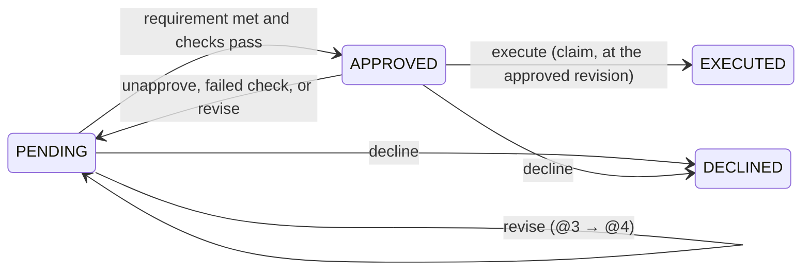
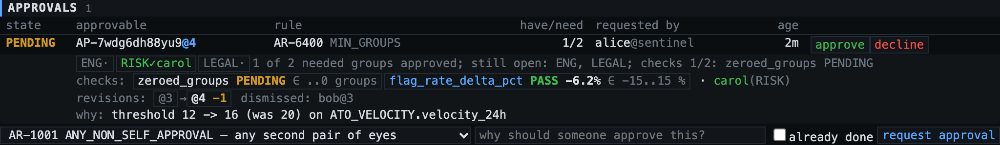
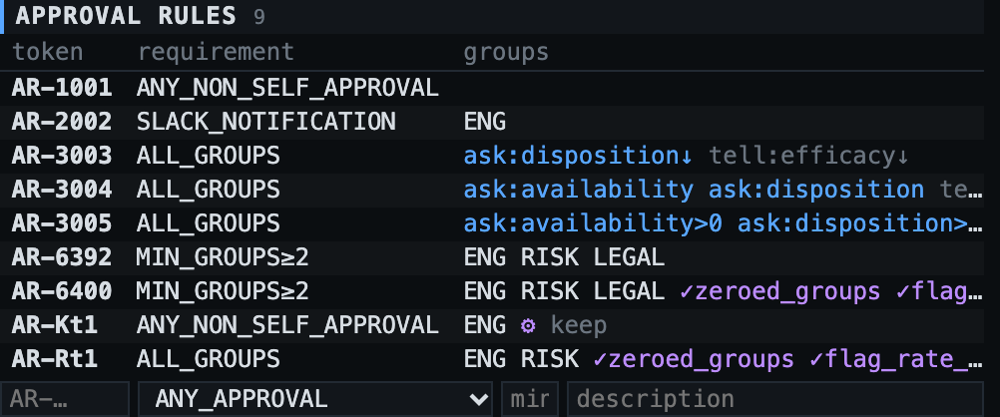

# Approvals

> Names like `sentinel`, `ATO_VELOCITY`, `trust-infra` and `alice` are a made-up example company: [who and what they are](example-world.md).

> **Nothing on this page is "the" policy.** TLC stores rules and evaluates them. Every rule shown
> here (two groups for a threshold change, people only, approvals dismissed on a new revision, ±15%)
> is one team's choice for one kind of change at one time. Another team, another system, or the same
> team next quarter will choose differently, and does so by writing a different rule, not by changing
> TLC. See [What a rule decides](#what-a-rule-decides).



The shape comes from the [`# approvals` section of the 2020 note](2020_scribble.md#approvals): approvable,
approvals, approval rule, rule-to-group. [decisions.md](decisions.md#approvals) says how each bullet was read.
Revisions, checks and agents were added after it.

| piece | is |
|---|---|
| **approval rule** ([`AR-6400`](example-world.md#AR-6400)) | the policy for one kind of action: who counts, how many, which checks, what a revision does |
| **rule group** | a label in the rule ([`ENG`](example-world.md#trust-infra)) → a directory group ([`trust-infra`](example-world.md#trust-infra)), `admins_only?`, `slack_channel?`, `email?` |
| **approvable** (`AP-…`) | one request: an external record **at a revision** (`sentinel/proposed_changes/1234@4`) + rule + `approval_context` + who asked |
| **revision** | one version of the record that was put up for approval; an approvable has one or more, all kept |
| **approval** | one principal's approval of one revision of one approvable, with `unapproved_at` when withdrawn or superseded |
| **check** | a machine's assertion about one revision (`flag_rate_delta_pct = -6.2`), required by the rule or merely reported |
| **thread** | discussion hung on the approvable; each comment carries the revision it was written at |



Reading that panel: the request is for `@4`; RISK is satisfied by carol; `zeroed_groups` has not
reported for `@4`, `flag_rate_delta_pct` passed at -6.2 against the rule's -15..15; the request has
been through `@3 → @4`, and moving to `@4` dismissed one approval (bob's, given at `@3`).

## What a rule decides

A rule is a point in a space of independent choices. Each has a shipped set of options; each set is
meant to grow.

| choice | field | options today | default | varies because |
|---|---|---|---|---|
| who can count | `groups`, `aspects` | fixed directory groups; owners of named aspects, resolved per record ([ownership](ownership.md#rule-aspects)) | none: anyone | a reorg should not edit policy, and policy should not name people |
| how many must agree | `requirement`, `min_groups` | the [requirement menu](#requirements-a-menu) | (required) | a typo fix and a rule disable are not the same risk |
| what else must hold | `checks` | named [checks](#checks-what-machines-assert), optionally bounded | none | what is measurable differs by system |
| what a new revision does | `on_revision` | `DISMISS` \| `KEEP` | `DISMISS` | re-review is cheap for some changes and a week for others |
| whether agents count | `agent_approvals` | `DENY` \| `ALLOW` | `DENY` | trust in an agent is earned per task |
| which records it is for | `applies_to` | entity types | any | ([ownership](ownership.md#which-rules-a-type-takes-applies_to)) |
| ask first or act first | `mode` on the request | `APPROVE` \| `RATIFY` ([break-glass](ownership.md#break-glass-mode-ratify)) | `APPROVE` | some things are on fire |
| whose impact gates it | `aspects[].threshold` | declared magnitude vs threshold ([impacts](ownership.md#impacts-asking-only-the-owners-a-change-actually-reaches)) | none | small changes should not train people to rubber-stamp |

The defaults are the conservative end of each choice, not a recommendation. Changing a rule is
itself guarded ([Changing a rule](#changing-a-rule)), and what a rule required when a request was
decided is in the log on the record.



## Requirements: a menu

`requirement` answers one question: given the live approvals and the rule's groups, is the people
half satisfied? The entries below are what ships. They are an enum because each needs a few lines of
evaluation code, not because the list is closed.

| `requirement` | satisfied when | self-approval |
|---|---|---|
| `ANY_APPROVAL` | ≥1 live approval | counts |
| `ANY_NON_SELF_APPROVAL` | ≥1 live approval not by the requester | refused |
| `MIN_GROUPS` | ≥ `min_groups` (default 2) groups matched | refused |
| `MAJORITY_OF_GROUPS` | > half of the rule's groups matched (`⌊G/2⌋+1`) | refused |
| `ALL_GROUPS` | every group matched | refused |
| `SLACK_NOTIFICATION` | immediately: groups' Slack channels are told | n/a |
| `EMAIL_NOTIFICATION` | immediately: groups' email addresses are told | n/a |

**Configurable.** `tlc.requirements: [ALL_GROUPS, MIN_GROUPS, ANY_NON_SELF_APPROVAL]` limits what a
rule may be written with on this deployment (unset = all). `GET /api/info` returns the offered
entries with their descriptions, and the console's rule form is built from that. A rule already on
an entry that later leaves the menu keeps working; a rule cannot be moved onto one that is off it.

**Extensible.** A new entry is one line in `enum class Requirement` (name, whether it needs groups,
whether it is notify-only, the description shown in the menu) and one branch in
`ApprovalEngine.evaluate`, which is a pure function of (requirement, groups, live approvals,
requester) with its own unit test. Nothing else knows the list: storage is a string, the API and UI
read `/api/info`.

Not on the menu yet, listed so that their absence reads as "not built" rather than "not allowed":

| candidate | would mean |
|---|---|
| `N_OF_GROUP` | k distinct people from one group ("two of trust-risk") |
| weighted quorum | groups carry weights; a threshold on the sum |
| veto | a named group's decline is terminal, anyone else's is advisory |
| staged | LEGAL is only asked once ENG and RISK have signed |
| expiring | an approval older than N days stops counting |
| per-requester | a different requirement when the requester is new, or is an agent |

**Who may approve.** If the rule has groups: members of at least one group's `directory_group`
(admins of it, where `admins_only`). If it has none: anyone. The approver is a named principal, a
person or (where the rule allows) an [agent](#agents); a bare service cannot approve. Everything
else is a 403 that says why. `GET /api/approvables/{AP}` includes a `you` block (allowed / reason /
via which groups) for the caller, and `GET /api/approvables?awaiting=me` is the caller's queue:
pending, approvable by them, not yet approved by them.

### Groups need distinct people

One person in both ENG and RISK satisfies **one** group, not two; otherwise "≥2 groups" collapses to
"one well-connected person". Which group they stand for is not fixed in advance: with bob ∈ {ENG, RISK}
and dave ∈ {ENG}, the answer is 2 groups *only if* bob is assigned to RISK. That is a maximum bipartite
matching between groups and approvers (`ApprovalEngine.matching`, Kuhn's augmenting paths); a greedy
first-fit under-counts exactly this case. The evaluation returned by every call shows the matching:

```
2/2  2/3 groups approved (needed 2)
  ENG      ✓ dave       candidates=bob,dave  <- trust-infra
  RISK     ✓ bob        candidates=bob       <- trust-risk
  LEGAL    ·            candidates=-         <- trust-legal
```

This reading is built into the group requirements as shipped. A team that wants the lenient one
(one person may stand for two groups) wants a different menu entry, not a flag on these.

### Membership is snapshotted at approval time

An approval stores `via_groups`: the rule groups the approver was entitled to at that moment.
Leaving `trust-infra` afterwards does not un-approve. The alternative, re-reading membership at
every evaluation, makes approvals flip without anyone acting; which is worse depends on how fast
your directory churns and how long requests stay open. To revoke, the approver withdraws
(`unapprove`) or anyone entitled declines.

## Revisions: what exactly is being approved

A record under review changes. `sentinel/proposed_changes/1234` is edited after the first review
comments, and the edit is the point of the review. So a request is never for "1234"; it is for one
version of it, written **`sentinel/proposed_changes/1234@3`**.

| | |
|---|---|
| the label | the source service's own: a counter (`3`), a content hash, a commit. Opaque to TLC, ≤64 chars, ordered by arrival, never reused within a request |
| filing | `POST /api/approvables {target, revision: "3", …}`. Omitted = the service does not version this record; everything below still works once it starts |
| a new version | `POST /api/approvables/{AP}/revise {revision: "4", context?}` by the requesting side (the filing service, else the requester) or an admin |
| what is kept | every revision, in `approvable_revisions`: label, context, who, when, how many approvals it displaced. Returned as `revisions[]` on the view |
| approvals | each records the revision it was given at. On revise, the rule's `on_revision` decides: `DISMISS` ends them (`superseded: true`), `KEEP` leaves them counting and marks them `stale` |
| checks | always per revision: a result for `@3` says nothing about `@4` |
| comments | stamped with the revision at the time ([comments](comments.md#on-a-request-and-at-a-revision)) |
| approving | `POST …/approve {revision: "3"}` is a 409 once the request is at `@4`: the approver looked at something that is no longer what is being decided. The panel always sends the revision it rendered |
| executing | `POST …/execute {revision: "4"}` is a 409 unless `@4` is the approved revision. Pass what you are about to apply |
| the record | `external_entities.revision` is the latest label TLC has been told for the record |

```
$ tlc ap show AP-7wdg6dh88yu9
AP-7wdg6dh88yu9  PENDING  sentinel/proposed_changes/1234@4  rule=AR-6400 (MIN_GROUPS)  by=alice  v8
  why: threshold 12 -> 16 (was 20) on ATO_VELOCITY.velocity_24h
  1/2  1 of 2 needed groups approved; still open: ENG, LEGAL; checks 1/2: zeroed_groups PENDING
    check zeroed_groups          PENDING             allowed ..0 groups   svc:sentinel
    check flag_rate_delta_pct    PASS     -6.2 %     allowed -15..15 %    svc:sentinel  “30d backtest at 16”
  revision @3   12:26:43 by alice         “threshold 12 -> 20 on ATO_VELOCITY.velocity_24h; backtest attached”
  revision @4   12:26:43 by svc:sentinel  dismissed 1 approval(s)  “threshold 12 -> 16 (was 20) …”
  approval bob        12:26:43 @3  via=ENG,RISK  SUPERSEDED 12:26:43  “eng ok”
  approval carol      12:26:44 @4  via=RISK
```

**Is an approvable versioned, or is each version its own approvable?** One approvable, many
revisions. The request, its requester, its rule, its discussion and its history are one thing that
people follow by one token; what changes underneath is the version on the table. Filing a fresh
approvable per version would scatter the conversation and lose "this is the second attempt". The
cost is that the parties and declared impacts resolved at filing stay frozen across revisions: if
`@4` changes *who should be asked* (a much larger impact, a different record), decline and refile.

`DISMISS` vs `KEEP` is the clearest case of a choice with no right answer. A rule for threshold
changes dismisses, because `@4` is a different threshold. A rule for copy edits keeps, because
re-collecting three sign-offs for a typo teaches people to stop reading. Both are in the
[example world](example-world.md#approval-rules).

## Checks: what machines assert

Some conditions are not opinions. "No rule group's flag rate drops to zero" and "overall flag rate
moves by at most 15%" are measurements, and a person approving should not be the one doing the
arithmetic. A rule can require them alongside its people.

```sh
tlc rule mk --token AR-6400 --requirement MIN_GROUPS --min 2 --desc "raise a rule threshold" --group ENG:trust-infra --group RISK:trust-risk --group LEGAL:trust-legal \
    --check 'zeroed_groups:max=0:unit=groups:reporter=sentinel:desc=rule groups whose flag rate drops to zero' \
    --check 'flag_rate_delta_pct:min=-15:max=15:unit=%:reporter=sentinel:desc=change in overall flag rate, 30d backtest'
tlc --service sentinel ap check AP-… flag_rate_delta_pct --value -6.2 --note "30d backtest at 16" --link https://sentinel.example/backtests/9917
```

| | |
|---|---|
| on the rule | `checks: [{name, description?, reporter?, min?, max?, unit?}]` |
| reporting | `POST /api/approvables/{AP}/checks {name, status?, value?, summary?, url?, revision?}`, **service callers only** (400 for a person or an agent: nobody vouches for a machine) |
| who decides | with `min` / `max` on the rule's check, the service reports the **value** and TLC compares (inclusive); the reporter's own `status` is ignored. Without bounds, the reporter's `PASS` / `FAIL` is taken |
| `reporter` | only that service's reports are accepted for the check (403 otherwise). Unset: any service |
| status | `MISSING` (nothing for this revision) · `PENDING` (running) · `PASS` · `FAIL` |
| gating | `APPROVED` needs the requirement met **and** every check named by the rule at `PASS` on the current revision. `evaluation` has `approvals_satisfied`, `checks[]`, and a `satisfied` that is both |
| re-runs | reports are append-only; the latest per (revision, name) counts. A later `FAIL` drops `APPROVED` back to `PENDING` |
| unnamed checks | a report the rule does not name is stored and shown (`required: false`) and never gates |
| history | `check_reports[]` on the view: every report, every revision |
| TLC runs | nothing. It has no access to the source service's data. The service (or its CI) computes and reports |

Why the bound lives on the rule: "15%" is policy. In the checker it is a constant someone has to
find; on the rule it is in the same place as "two groups", is guarded by the same change control,
shows in the same table, and can be 15 for one action and 5 for another against the same
measurement. Expressing a condition as a number with bounds (`zeroed_groups ≤ 0` rather than a
boolean) also means the failing value is on the record.

Check results and declared [impacts](ownership.md#impacts-asking-only-the-owners-a-change-actually-reaches)
are different instruments. An impact is declared once at filing and chooses **who is asked**. A
check is measured per revision and decides **whether it can pass at all**.

Limits, on purpose so far: a `FAIL` cannot be waived by a person (edit the rule, with `force`, or
revise the change); bounds are a closed interval on one scalar; there is no timeout that turns a
check which never reports into a failure, it simply stays `MISSING` and the request stays `PENDING`.

## Agents

Not every principal is a person. An agent here is software acting on its own judgement: a review
bot that reads the diff and the backtest, a triage agent that files changes. It is not a service
(which relays what a person did, or reports a measurement) and it is not a check (which asserts a
number). It authenticates and joins directory groups like anyone else.

| | |
|---|---|
| marking one | `PUT /api/agents/{name}?operator=<ldap>&description=` (admin); `tlc agent add reviewbot --operator dave`. `GET /api/agents` |
| what it can always do | tag, log, comment, open threads, file requests, revise and execute its own |
| approving | counts only under a rule with `agent_approvals: ALLOW`. Under `DENY` (the default) it is a 403 naming the rule |
| the operator | the person who answers for the agent. An agent's approval does not count on its operator's request, an operator cannot approve their agent's request, and agent + operator on one request count once |
| the record | the approval stores `agent: true` and the operator at the time; the log line reads `approved by agent reviewbot (operated by dave) as ENG` |

Whether an agent's approval should count is a per-rule question with a moving answer: plausibly yes
for a copy edit, no for disabling a fraud rule, and the line shifts as a particular agent builds a
record. An agent that may not approve still reviews: its comment on the request is on the thread
where the human approvers read it ([screenshot](comments.md#on-a-request-and-at-a-revision)).

Under OIDC an agent is whatever the issuer says its username is; TLC does not yet take "is an agent"
from a token claim, only from this table.

## Lifecycle

- **Request**: `POST /api/approvables {target, rule, revision?, context?, client_id?, requested_by?}`.
  A person or agent calling directly *is* the requester. Only a service caller may set
  `requested_by` (it vouches for its own user); otherwise "non-self" is dodged by lying about who
  asked. `client_id` makes retries idempotent; reusing one for a different target/rule is a 409.
- **Approve / unapprove**: idempotent (`changed`). Extra approvals after APPROVED are accepted.
  Withdrawing before execution re-evaluates and can drop APPROVED → PENDING (`approved_at` cleared).
- **Revise**: see [Revisions](#revisions-what-exactly-is-being-approved). Allowed while the request is open.
- **Check**: see [Checks](#checks-what-machines-assert). Each report re-evaluates.
- **Decline** (terminal): the requester (withdrawing), anyone who could approve, or an admin.
- **Execute** (terminal): `POST …/execute {revision?, expected_version?}`. This is a **claim**, not a report:
  call it *before* applying the change and apply only if `changed: true`. Racers serialize on the
  row lock; exactly one gets `true`. Only the requesting side may claim (the service that filed it,
  `requested_via_service`, else the requester) or an admin. It re-checks the whole evaluation under
  the lock, so a withdrawal or a failing check that raced the claim wins.
- Every mutation bumps `version`, republishes the row on the `approvables` feed (with its current
  `revision`), and writes a `tlc.approvals` log entry on the record.

## Approvers from ownership, and break-glass

Two extensions, both documented in [ownership.md](ownership.md):

- A rule may list **aspects** (`aspects: [{aspect, mode, scope, fallback_group}]`). At filing, the
  owners of those aspects are resolved, frozen onto the approvable (`parties`), and the CONSENT ones
  are appended to the rule's groups for that approvable. Everything above applies unchanged.
- `mode: "RATIFY"` on the request is break-glass: `ACTED → RATIFIED | REVERTED` with a TTL, pullable
  only by an owner of the target or of something built on it. `execute` does not apply (409).
  Checks apply: a break-glass under a rule with checks is not RATIFIED until they pass.

## Changing a rule

Description: always. What it *requires* (requirement, `min_groups`, groups, `checks`,
`on_revision`, `agent_approvals`): 409 while approvables are open under it, so that a change of
policy under requests in flight is something an admin does on purpose. (A change to `aspects`
counts, but only affects approvables filed afterwards: open ones keep their frozen parties.)
`?force=true` applies the change and re-evaluates every open approvable in the same transaction
(they may flip either way; each flip is logged with the reason). Rules with open approvables can't
be deleted. Rule, directory and agent writes need the admin capability.

Rules are not versioned: an approvable follows its rule by token. What the rule said when a request
was decided is recoverable from the log lines (which quote the evaluation), not from a snapshot.

## Notifications

Rows go into `notifications` (a transactional outbox) with the state change and are delivered
after commit by the background loop: at-least-once, 5 attempts, then `FAILED`.

| event | when | to |
|---|---|---|
| `REQUESTED` | approvable created | every group's `slack_channel` and `email` |
| `REVISED` | moved to a new revision | same; the text says how many approvals were dismissed or kept |
| `APPROVED` / `DECLINED` / `EXECUTED` | on the transition | same |
| `NOTIFY` | created under a notification-only rule | Slack *or* email, per the requirement |
| `ACTED` / `RATIFIED` / `REVERTED` | break-glass filed / blessed / expired or pulled back | same, plus NOTIFY parties |

Ownership-resolved parties are reached at their group's contact (`/api/directory/{group}/contact`);
NOTIFY-mode owners and stakeholders get every event for the approvable, marked `[fyi: …]`.

Transport (`NotificationTransport`): SLACK posts to `tlc.slack_webhook_url` if configured; anything
else is written to the service log and marked `LOGGED`. `GET /api/notifications?approvable=AP-…`
shows what was, or would have been, said to whom.

## The directory stand-in

`directory_memberships (directory_group, ldap, is_admin)` plus `PUT/DELETE /api/directory/{group}/members/{ldap}`
stands in for the real group directory, and `agents (name, operator)` for whatever marks a principal
as an agent there. All approval logic reaches them through `Directory.memberOf` and
`Directory.agent`; pointing those at the real thing is the integration.
