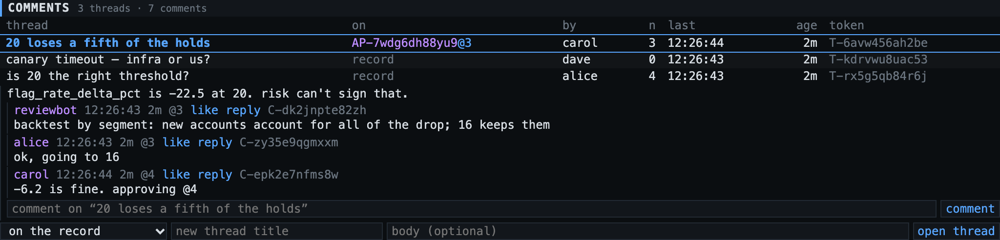

# Comments

`threads` hold a title/body and optionally point at a target. `comments` nest arbitrarily under a
thread. `likes` record who liked which comment, and when they stopped.

A thread's target is anything: a record (`sentinel/proposed_changes/1234`), an approval request
(`AP-…`), another thread, or nothing.

## On a request, and at a revision

The discussion that decides a change belongs on the request, not scattered across the record: it is
what an approver reads before signing and what an auditor reads after. So a thread can be opened on
an approvable, and since the thing under review [changes while it is discussed](approvals.md#revisions-what-exactly-is-being-approved),
every thread and every comment records the **revision its target was at when it was written**.

| | |
|---|---|
| open on a request | `POST /api/threads {target: "AP-…", title}` · `tlc thread mk "…" --target AP-…` · the "on …" selector in the panel |
| `revision` on a thread | where it was opened. An approvable target: its revision then. A record target: the latest revision TLC had been told for that record. Does not move |
| `revision` on a comment | the same lookup at the moment the comment was written. A thread opened at `@3` collects `@3` comments, then `@4` ones after a revise, so "that was about the old version" is on the page |
| pin on purpose | `POST /api/threads {target, revision: "3"}` opens a thread about an older revision |
| where they show | `GET /api/approvables/{AP}` → `threads[]`; `GET /api/summary?target=<record>` lists the record's threads **and** those on its approvables, with what each is `on` |
| who | people, [agents](approvals.md#agents) and services alike. An agent that may not approve under a rule can still say what it found |

TLC does not mark an old comment "outdated" or hide it. Whether a `@3` comment still applies at `@4`
is a judgement, and the revision stamp is the evidence for making it.

## Nouns × verbs

| | create · `mk` | read · `ls` | update · `edit` | destroy · `rm` |
|---|---|---|---|---|
| **thread** | `POST /api/threads {title, body?, target?, revision?}` | `GET /api/threads?target=&creator=` · `GET /api/threads/{T}` (thread + all comments) | `PATCH /api/threads/{T} {title?, body?}` | `DELETE /api/threads/{T}` |
| **comment** | `POST /api/comments {thread? , parent_comment?, content}` · `POST /api/threads/{T}/comments` | `GET /api/comments?thread=` · `GET /api/comments/{C}` | `PATCH /api/comments/{C} {content}` | `DELETE /api/comments/{C}` |

Likes: `POST /api/comments/{C}/like`, `…/unlike`, `GET …/likes[?include_unliked=true]`.
The CLI accepts either verb set: `tlc comment create|mk`, `read|show|ls`, `update|edit`, `destroy|rm`.

## How it behaves

- **`thread_path`** is the materialized ancestor chain, zero-padded ids joined by `/`
  (`0000000007/0000000012`). `ORDER BY thread_path` under index `(thread_id, thread_path)` returns
  the whole tree depth-first, oldest-first, in one range scan; `depth` comes along for indenting.
  A subtree is a prefix scan.
- **Depth cap.** A reply to a comment already at `max_comment_depth` (16) is filed as its sibling,
  so the path can't outgrow its column and UIs don't indent off the screen.
- **`cached_comments`** on the thread is the live comment count (plus `last_comment_at`), updated in
  the comment's own transaction under the thread row lock — it can't drift. `likes` on a comment is
  cached the same way under the comment row lock.
- **Edit/rm** are for the author or an admin; anything else is a 403 with the reason.
- **rm is a tombstone.** The content is erased in the database, `deleted_at` is set, and the row
  stays so replies keep their parent. Replying to or liking a tombstone is a 409.
- **Deleting a thread** hides it from lists and refuses new comments; it stays readable by token.
- **Likes are episodes.** Unlike stamps `unliked_at`; liking again inserts a new row. A generated
  `active` column with a unique key on `(comment_id, liked_by, active)` allows one open episode per
  person per comment while keeping history. Like/unlike are idempotent (`changed: false`).
- **Reply by parent alone.** `POST /api/comments {parent_comment, content}` infers the thread.
- `liked_by_me` in comment payloads is relative to the caller.
- Threads and comments are published on the `threads` / `comments` feeds; a comment's `shard` is its
  thread's, so one consumer shard sees a whole conversation.
- Services may comment too; the author is then `svc:<name>`.
- Content is stored and returned as plain text. The bundled UIs escape it; they don't render markdown.
