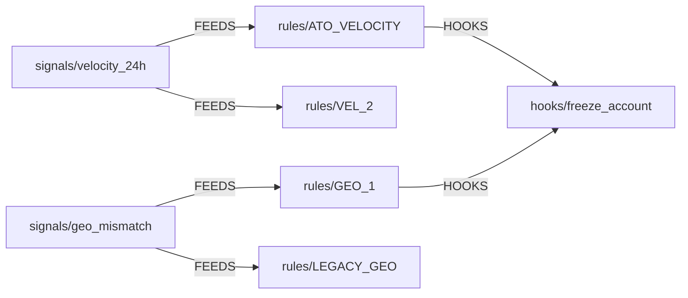

# The example world

Every doc, demo, test and screenshot uses the same made-up company. None of these names mean anything
to TLC: they are rows that `scripts/seed.sh` creates. This page says what each one stands for.

The company runs a fraud rule engine and has a Trust org split into five teams.

The rules, thresholds and group choices below are this company's, on the day the seed was written.
They are examples of what can be expressed, not advice: a different org would pick other groups,
other bounds, and other answers to "do agents count" and "does an edit void approvals".

## Services and record types

| name | is | records in the seed |
|---|---|---|
| `sentinel` | the fraud rule engine: the *source service* whose records TLC annotates. Scores events against signals, fires rules, runs hooks | |
| `sentinel/proposed_changes` | a change request against a rule, waiting on review. **It is edited while under review, and sentinel keeps every version**: `1234@3` is the third. What tags, comments and plain approvals are shown on | `1234` raise ATO_VELOCITY velocity limit: reviewed at `@3` (12 → 20), changed to `@4` (12 → 16) · `1235` retire legacy geo rule (`@1`) · `1236` comment-only change |
| `sentinel/signals` | a computed input a rule reads | [`velocity_24h`](#velocity_24h) · [`geo_mismatch`](#geo_mismatch) |
| `sentinel/rules` | a condition over signals that flags an account | [`ATO_VELOCITY`](#ATO_VELOCITY) · [`VEL_2`](#VEL_2) · [`GEO_1`](#GEO_1) · [`LEGACY_GEO`](#LEGACY_GEO) |
| `sentinel/hooks` | an action taken when a rule fires | [`freeze_account`](#freeze_account) |
| `billing/invoices` | a second, unrelated service, used by the entities demo to show that types are per service | |
| `rxHHMMSS/…` | a throwaway copy of the sentinel types that `scripts/demos/08-ownership.sh` makes per run (`R1`–`R3`, `payout` trigger) so re-runs don't collide | |

## Records

| record | is | why it is in the seed |
|---|---|---|
| `signals/velocity_24h` | count of money-movement attempts per account over 24 h | carries the open break-glass ("stale since 14:02; pinned to last-known-good") |
| `signals/geo_mismatch` | login geography disagrees with the account's usual one | has no `availability` owner: an **UNOWNED** cell |
| `rules/ATO_VELOCITY` | account-takeover rule: too many attempts in 24 h. The main example rule | cleanly **OWNED** on every aspect, one stakeholder, an open "disable a rule" request |
| `rules/VEL_2` | a second velocity rule | `efficacy` claimed by both OPS and DS: **CONTESTED**. Also the declared-impact example |
| `rules/GEO_1` | the current geo rule | ordinary, owned |
| `rules/LEGACY_GEO` | a geo rule nobody has looked at since a migration | `availability` last affirmed 120 days ago: **LAPSED**; `disposition` **UNOWNED** |
| `hooks/freeze_account` | freezes the flagged account | two rules deep from a signal, so it shows up in "who is affected downstream" |

## Teams (directory groups)

| group | team | rule label | members | reached at |
|---|---|---|---|---|
| `trust-infra` | engineering: runs the rule engine in prod | `ENG` | bob, dave | `#trust-infra-oncall` |
| `trust-ops` | operations: reviews the accounts that get flagged | | olga, omar | `#ops-review` |
| `trust-ds` | data science: models and whether rules still catch fraud | | dana | `ds-oncall@example.com` |
| `trust-risk` | risk policy | `RISK` | bob, carol (group admin) | |
| `trust-legal` | legal | `LEGAL` | lena | `legal@example.com` |

## People

| ldap | is |
|---|---|
| alice | an engineer in no group: the one who *requests* things |
| bob | in `trust-infra` and `trust-risk`; shows that one person can't fill two groups' slots |
| carol | admin of `trust-risk`; the only one who counts for an admins-only rule group |
| dave | second member of `trust-infra` |
| lena | `trust-legal` |
| olga, omar | `trust-ops` |
| dana | `trust-ds` |
| mallory | in nothing; used to show refusals |
| reviewbot | an **agent**, operated by dave, in `trust-infra`: reads the diff and the backtest, comments on requests, and approves only under rules that admit agents |
| traviscj | the TLC admin (`admins` in config): edits rules and the directory. `root` in the tests |

## Aspects

Declared on `sentinel/rules` with these descriptions (signals and hooks declare one each):

| aspect | means | default owner |
|---|---|---|
| `availability` | the rule is deployed, evaluates on every eligible event in prod, and returns inside its latency budget | `trust-infra`, type-wide |
| `disposition` | every account the rule flags lands in a review queue that is staffed, and is worked inside the SLA | `trust-ops`, claimed rule by rule |
| `efficacy` | measures whether we are catching enough of the fraud that exists at a low enough false-positive cost | `trust-ds`, type-wide |

## Approval rules

| rule | action it stands for | requirement | who |
|---|---|---|---|
| `AR-6392` | approving a new ATO_VELOCITY rule | `MIN_GROUPS` ≥ 2 | fixed groups ENG, RISK, LEGAL |
| `AR-6400` | raise a rule threshold | `MIN_GROUPS` ≥ 2, **and** checks `zeroed_groups` ≤ 0, `flag_rate_delta_pct` ∈ −15..15 (both reported by sentinel) | fixed groups ENG, RISK, LEGAL; people only; a new revision dismisses approvals |
| `AR-1001` | any second pair of eyes | `ANY_NON_SELF_APPROVAL` | anyone but the requester |
| `AR-2002` | FYI-only changes | `SLACK_NOTIFICATION` | nobody approves; ENG is told |
| `AR-3003` | pin a signal to last-known-good (signals only) | `ALL_GROUPS` | owners of `disposition` downstream consent; `efficacy` owners told |
| `AR-3004` | disable a rule (rules only) | `ALL_GROUPS` | owners of `availability` and `disposition` consent; `efficacy` told |
| `AR-3005` | change a rule threshold (rules only) | `ALL_GROUPS` | as above, but `availability` only above 0 and `disposition` only above 50 flags/day of declared impact |

Rules named `AR-<letter><HHMMSS>` (`AR-K094742`, …) are made by a demo run and can be ignored.
`scripts/demos/09-revisions-checks-agents.sh` makes a pair with opposite choices on purpose: `AR-R…`
(dismiss on revision, people only, two checks) and `AR-K…` (keep approvals, agents count).

## Tags

`ato` (about account takeover) · `q4-freeze-exempt` · `needs-backtest` (added and removed, to show
history). Others in the console (`demo`, `urgent`, `old-…`) come from demo runs.
