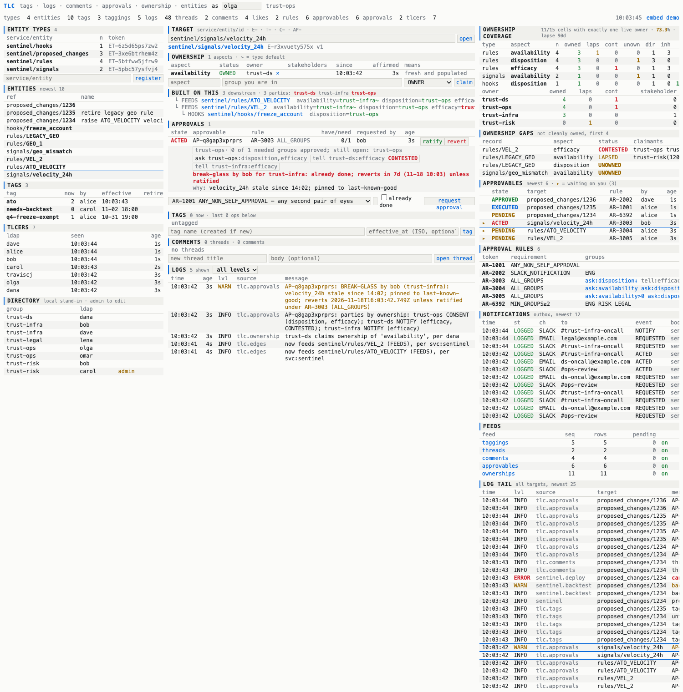

# Ownership

"Who owns rule R?" has no single answer here: ENG owns that it *evaluates* in prod, OPS owns that
what it flags gets *reviewed*, DS owns that it still *catches* what it should. So ownership is
recorded per **aspect** of a record, not per record.

```
ownership = (target, aspect, owner, role, effective interval)      owner = a directory group
```

| | |
|---|---|
| **aspect** | open vocabulary, like tag names: `availability`, `disposition`, `efficacy`, … |
| **role** | `OWNER` — accountable; asked to consent when an approval rule names the aspect. `STAKEHOLDER` — told, never asked; any number. |
| **target** | `service/entity/id`, or `service/entity/*` for a type-wide default |
| **the invariant** | at most one `OWNER` per (record, aspect) at any instant |

Code: `Ownership.kt` · tables `ownerships`, `ownership_aspects`, `entity_edges` · demo
`scripts/demos/08-ownership.sh` · CLI `tlc own …`, `tlc edge …`.

## Cell status

A *cell* is one (record, aspect).

| status | means |
|---|---|
| `OWNED` | exactly one live OWNER |
| `CONTESTED` | two or more OWNERs. **Not refused at write time**: the second claim is recorded and the cell says so until someone releases. Refusing the write would only hide the disagreement. |
| `UNOWNED` | no OWNER (stakeholders don't count) |
| `LAPSED` | one OWNER, but nobody has claimed or affirmed it for `tlc.ownership_lapse_days` (90) |

## Claims are an op log

`CLAIM | RELEASE | AFFIRM`, append-only, effective-dated — the same shape as taggings, so:

- `GET /api/ownership?target=…&at=<then>` — who owned it then.
- `&known_at=<then>` — what TLC would have answered then (ignores later backdated fixes).
- Re-claiming what you already hold in the same role is recorded as `AFFIRM` (`changed: false`) and
  resets the lapse clock; `since` does not move.
- `POST /api/ownership/affirm {owner}` affirms everything a group holds (narrow with `target`,
  `aspect`). That is the quarterly "yes, still ours".
- `POST /api/ownership/transfer {target, aspect, from, to}` = RELEASE + CLAIM at one instant: no
  moment with zero or two owners. The **giver** does it.

**Who may write.** A human may claim / release only for a group they are in. Admins and service
callers (a source of truth syncing in) may speak for any group. Consequence worth knowing: on an
UNOWNED cell, the first group to claim it owns it. That is the squishiness being modelled; the
claim is in the log and on the `ownerships` feed.

## Type defaults

A claim on `sentinel/rules/*` applies to every record of the type. Per aspect, a record's own OWNER
claim **overrides** the default (it does not contest it); stakeholders are unioned. `source` on each
holder is `DIRECT` or `TYPE`; the CLI and UI mark inherited owners `~`.

## What an aspect means

An aspect name is one word; what it commits the owner to is not obvious from it, and differs by type
(`availability` of a rule is not `availability` of a signal). Each (type, aspect) carries a
description, written when the aspect is declared and editable by declaring it again:

```sh
tlc own expect sentinel/rules efficacy --desc "measures whether we are catching enough of the fraud that exists at a low enough false-positive cost"
tlc own aspects --type sentinel/rules        # full text
```

It is returned as `description` on every cell (`GET /api/ownership`), shown as the `means` column
of the ownership panel and of `tlc own of`, and is the text to argue about when a cell is CONTESTED.
An aspect that is claimed but was never declared for the type has none.

## Coverage

```
GET /api/ownership/coverage[?type=service/entity][&at=]     tlc own coverage
GET /api/ownership/gaps[?type=&aspect=&status=&owner=]      tlc own gaps
```

`pct_owned` = OWNED cells / cells, per (type, aspect) and in total, plus a per-owner rollup.
`direct` / `inherited` split the owned cells by whether the claim is on the record or the type default.

The denominator is **records of the type × aspects *expected* of the type**. Expected aspects are
declared explicitly (`POST /api/ownership/aspects {type, aspect}`, `tlc own expect`). A claim on an
undeclared aspect shows on that record but does not enter the denominator — otherwise one stray
claim would turn every other record of the type into a gap.

## The dependency graph

```
POST /api/edges {from, to, kind?}        from ──▶ to   "to is built on from"
signal ──FEEDS──▶ rule ──TRIGGERS──▶ trigger ──HOOKS──▶ hook
```

Source services push the edges they know; TLC mirrors, it is not the master. Edges are
current-state (no effective dating), idempotent to write, and cycles are tolerated.

`GET /api/ownership/affected?target=X[&direction=up]` (`tlc own affected X`) walks the closure and
returns every node with its cells plus the distinct parties: who is on the hook if X breaks
(down), or what X depends on (up).

## Approval rules bind to the action, not the entity

Ownership says who holds each aspect of a record. It does not say who decides, because that depends
on **what is being done** to the record. Detaching a hook, disabling a rule and changing a threshold
all touch the same rule and need different people:

| action (one rule each) | `availability` | `disposition` | `efficacy` |
|---|---|---|---|
| detach hook (shadow mode) | notify | **consent** | notify |
| disable a rule (`AR-3004`) | **consent** | **consent** | notify |
| change a threshold | notify | notify | **consent** |
| pin a signal to last-known-good (`AR-3003`) | – | **consent**, downstream | notify, downstream |

So the two halves are kept apart and only meet when a request is filed:

```
rule       = an action class:  aspect -> CONSENT | NOTIFY        (no entity, no type, no group names)
ownership  = a record:         aspect -> group                   (no knowledge of any action)
approvable = (target, rule):   resolve aspect -> group on that target, freeze the result
```

- **A rule is never attached to an entity or an entity type.** There is no "the approvers for
  `sentinel/rules/ATO_VELOCITY`"; there is only "the approvers for *disabling* `ATO_VELOCITY`", computed from
  `AR-3004` and whoever owns its aspects at filing time.
- **One rule covers every record it is filed against.** `AR-3004` asks trust-infra for one rule and a
  different team for another, without either team appearing in the rule.
- **Reorgs touch ownership, policy changes touch rules.** A group taking over `disposition` is one
  `tlc own transfer`; no rule is edited. Deciding DS must consent to disabling is one rule edit; no
  claim changes.
- **The source service picks the rule**, because only it knows which action the request represents.
  TLC has no action vocabulary of its own: the rule token *is* the action's identity.

### Which rules a type takes (`applies_to`)

A rule can list the entity types it is for:

```sh
tlc rule mk --token AR-3004 --desc "disable a rule" --applies-to sentinel/rules --aspect availability …
tlc rule edit AR-3004 --applies-to sentinel/rules --applies-to sentinel/triggers    # replaces the list; no --force needed
tlc rule edit AR-3004 --applies-to ""                                             # clears it
```

Checked when an approvable is filed, both ways round, and a miss is a **409**:

| | |
|---|---|
| rule lists types, target's type is not one | `AR-3004 (disable a rule) applies to sentinel/rules, not sentinel/signals` |
| target's type is listed by some live rule, but not by this one | `sentinel/rules only takes AR-3004; AR-1001 does not list it in applies_to` |
| neither side lists anything | allowed, as before |

So listing a type on any rule **closes** it: a weaker generic rule can no longer be filed against it
to get an easier set of approvers. Open approvables are untouched by a change to the list.

What this does not catch: two rules that both list the type. A service that files "disable" under
the threshold rule still gets the threshold approvers; TLC cannot see what the service then does.

Rules with only fixed groups (the original `AR-…` shape) still work and can be mixed with aspects:
fixed groups for "always ask ENG", aspects for "ask whoever owns this".

### Rule aspects

A rule can list aspects instead of (or as well as) fixed groups:

```json
{"token": "AR-3004", "requirement": "ALL_GROUPS", "description": "disable a rule",
 "aspects": [{"aspect": "availability"},
             {"aspect": "disposition", "scope": "DOWNSTREAM", "fallback_group": "trust-ops"},
             {"aspect": "efficacy", "mode": "NOTIFY"}]}
```

| field | |
|---|---|
| `mode` | `CONSENT` (default): the aspect's owner becomes an approving group. `NOTIFY`: told only. |
| `scope` | `TARGET` (default): owners on the record. `DOWNSTREAM`: also owners on everything built on it. |
| `fallback_group` | stands in when a CONSENT aspect has no owner in scope. Without one, filing is a **409** naming the aspect. |
| `threshold`, `unit` | impact gate: the mode applies only when the declared impact exceeds it. See "Impacts" below. |

When an approvable is filed, TLC resolves the parties **then** and freezes them in
`approvable_parties` (returned as `parties` on the view). Ownership moving later does not change who
was asked about an open request — the same reasoning as the `via_groups` membership snapshot.

- CONSENT parties are appended to the rule's groups for that approvable; the existing requirement
  types (`ALL_GROUPS`, `MIN_GROUPS`, …) and the distinct-people matching run unchanged.
- A **CONTESTED** aspect yields every claimant as a consenting group: under `ALL_GROUPS` they all
  have to agree. That is what being contested costs.
- **Stakeholders** of a named aspect are always notified, whatever the mode.
- A group reached by several aspects appears once, with the aspects listed.
- Where to reach a group: `PUT /api/directory/{group}/contact?slack_channel=&email=`.

## Impacts: asking only the owners a change actually reaches

A rule says which aspects an action *can* touch. Most instances of the action touch fewer: a
threshold nudge that moves 12 flags a day does not need OPS to approve it, and asking anyway trains
OPS to approve without reading. So the source service declares what this particular change does, and
a threshold on each rule aspect decides who is asked.

```sh
tlc rule mk --token AR-3005 --requirement ALL_GROUPS --desc "change a rule threshold" --applies-to sentinel/rules \
    --aspect availability:above=0 --aspect disposition:above=50:unit=flags/day --aspect efficacy
tlc --service sentinel --as alice ap mk sentinel/rules/VEL_2 AR-3005 \
    --impact availability=0 --impact "disposition=-18:flags/day:30d backtest" --impact "efficacy=?"
```

```json
POST /api/approvables   (X-TLC-Service: sentinel)
{"target": "sentinel/rules/VEL_2", "rule": "AR-3005",
 "impacts": [{"aspect": "availability", "magnitude": 0},
             {"aspect": "disposition", "magnitude": -18, "unit": "flags/day", "note": "30d backtest"},
             {"aspect": "efficacy", "magnitude": null}]}
```

For each rule aspect, with `m` the declared magnitude and `T` the rule's `threshold`:

| declared | rule aspect is CONSENT | rule aspect is NOTIFY |
|---|---|---|
| `\|m\| > T` | asked | told |
| `\|m\| <= T` | **told, with the number** | **skipped** |
| `magnitude: null` (the service does not know) | asked | told |
| aspect not in `impacts` at all | asked | told |
| rule aspect has no `threshold` | asked | told |

- **Only a positive, small declaration reduces anything.** Unknown, undeclared and unmeasured all
  keep the full mode, so not measuring is never the cheap path.
- **The sign is ignored.** -340 flags/day is as much OPS's business as +340.
- **A demoted owner is still told**, and the notification carries the declared number and the
  threshold (`declared disposition=-18 flags/day (|-18| <= 50 flags/day: told, not asked)`), so a
  wrong declaration is visible to exactly the group it bypassed.
- **Units must match** when the rule aspect names one: a 400, not a silent comparison of
  flags/hour against flags/day.
- **Only a service caller may declare impacts** (400 for a human). The declaration picks the
  approvers; it has to come from the system that computed it, the same way only a service may set
  `requested_by`.
- **If nobody is left to ask**, the approvable is APPROVED at filing (RATIFIED, for break-glass),
  with the usual notifications. That is the intended end state for a change with no impact above any
  threshold, and it is why the thresholds are the policy worth reviewing.
- **Frozen like the parties.** The view returns `impacts`: per aspect, what was declared, the
  threshold at the time, the resulting `effect` (`CONSENT` / `NOTIFY` / `SKIPPED`, or `NONE` for a
  declared aspect the rule does not name) and the `reason`. The log on the target gets the same line,
  at WARN when anything was demoted.
- A group that owns two aspects, one demoted and one not, is still asked. A CONTESTED aspect below
  its threshold tells every claimant and asks none.

Limits: the magnitude is one number per aspect, in whatever unit the service and the rule agree on;
TLC does not compute, check or backfill it. With `MIN_GROUPS`, demotion can leave fewer groups than
the minimum, and filing is then a 409 as it is whenever too few groups resolve.

## Break-glass (`mode: RATIFY`)

For "it is breaking now": act first on something reversible, ask after.

```
POST /api/approvables {target, rule, mode: "RATIFY", context, ttl_seconds?}
ACTED ──rule satisfied──▶ RATIFIED          (it stands)
  └────TTL, or pulled back──▶ REVERTED      (the source service undoes it)
```

- **Who may pull it**: a member of a group that owns any aspect of the target *or of anything built
  on it* (or one of the rule's groups, or an admin). Anyone else gets a 403 listing those groups.
- **Nobody ratifies their own pull**, whatever the rule's requirement.
- **TTL**: `ttl_seconds` (default `tlc.ratify_ttl_seconds`, 4 h; max 7 d). Unratified at expiry →
  `REVERTED` by the background loop.
- **Reverting early** belongs to the side that pulled it: the requester, their acting group, or an
  admin. Everyone else's lever is to withhold ratification and let the TTL revert it. Otherwise two
  owners can flip a thing back and forth all night.
- TLC never undoes anything itself. `REVERTED` on the `approvables` feed is the instruction; the
  source service applies it, exactly as it applies `APPROVED` → execute in the ask-first flow.
- Notifications: `ACTED`, then `RATIFIED` or `REVERTED`, to consenting groups, NOTIFY owners and stakeholders.

What TLC does not decide: which direction is "safe". Turning a fraud rule off is loss; leaving a
broken one on is blocked customers. Prefer the narrowest reversible cut (detach a hook, pin a signal
to last-known-good) as the thing a break-glass rule covers, and keep "disable the rule" ask-first.

## Feed

`/_feeds/fetch/ownerships` — the claim log (immutable rows, so it is an event log, like taggings).


