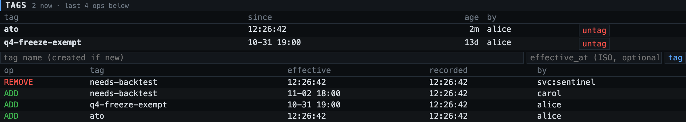

# Tags

A **tag** is a name with an effectivity window. A **tagging** is one immutable operation,
`ADD` or `REMOVE`, of a tag on a target, effective at some instant, by some ldap and/or service.
Nothing in `taggings` is ever updated or deleted.

## State is a query

> target X carries tag G at instant *t* ⇔ the last operation on (X, G) with `effective_at ≤ t`
> — ordered by `(effective_at, id)` — is an `ADD`.

So the note's four APIs are two queries:

| API | call |
|---|---|
| tag / untag | `POST /api/taggings/tag` · `/untag` `{target, tag, effective_at?, note?, create_tag?}` |
| is tagged | `GET /api/taggings/is-tagged?target&tag` |
| was tagged (at an instant) | same, `&at=<ISO>` |
| was tagged (ever / in a window) | `GET /api/taggings/was-tagged?target&tag[&from&to]` → `was_tagged`, `throughout`, `intervals[]` |
| what's on X / what has G | `GET /api/taggings/tags?target` · `GET /api/taggings/targets?tag` (both take `at`) |
| the op log | `GET /api/taggings?target=&tag=` |

Intervals are half-open `[from, to)`: at the instant of a `REMOVE` the target is already untagged.

## Things worth knowing

- **Idempotent.** An `ADD` when the target is already tagged *as of that effective time* writes
  nothing and returns `changed: false` (same for `REMOVE`). Retries are free.
- **Back- and forward-dating.** `effective_at` may be any instant. The response reports both
  `tagged` (state at the op's effective time) and `tagged_now`; they differ when a later-effective
  op already exists, or the op is in the future.
- **Two clocks.** `effective_at` is when it was true; `created_at` is when TLC learned it.
  `known_at=<ISO>` on any read ignores operations recorded after that instant — "what would TLC
  have said last Tuesday?" — which is the question an audit actually asks after a backdated fix.
- **`since`** survives redundant ADDs (ADD@Jan, ADD@Mar ⇒ since Jan).
- **Tag effectivity.** `DELETE /api/tags/{name}` retires a tag (`ineffective_at`). After that:
  new ADDs effective at/after retirement are 409; REMOVEs always work; what was tagged stays tagged
  and queryable. `POST /api/tags` on a retired name un-retires it. ADDs effective before the tag's
  own `effective_at` are refused too (a tag auto-created by a backdated ADD starts at that ADD).
- **Names** are lower-cased and must match `[a-z0-9][a-z0-9_.:-]{0,95}` (`risk:tr`, `q4-freeze-exempt`).
- **ldap and service** are separate columns, as in the note. A person or agent through the UI or CLI sets `ldap`; a
  service sets `service`; a service acting for a user sets both.
- **Concurrency.** Each operation locks its tag row, so check-then-insert can't interleave for one tag.
- **Feed.** Every op is published on the `taggings` feed, sharded by target.
- Each tag/untag of an external record also writes a `tlc.tags` log entry on that record.

## Cost model

State is folded from the op log at read time: `is-tagged` reads one target×tag's ops (index
`(target_key, tag_id, effective_at, id)`); `targets?tag=` folds the *whole* tag's log. Fine to
~10⁵ ops per tag. Past that, add a materialized current-state table maintained in the op's
transaction — the op log stays the source of truth and the temporal queries don't change.
